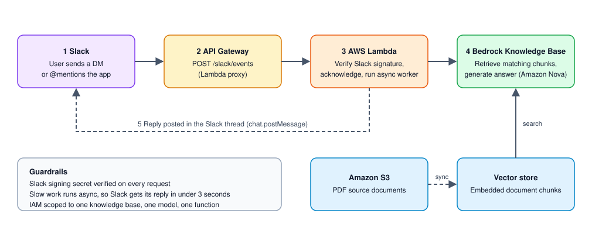

# RAG-Knowledge-Base

A Slack assistant that answers questions about data pipelines. It searches a set of PDF documents using an Amazon Bedrock knowledge base (retrieval-augmented generation) and replies in the Slack thread.



## How it works

1. **Slack** sends an event to the app's Request URL when someone DMs the bot or @mentions it.
2. **API Gateway** receives the `POST /slack/events` request and passes it to Lambda.
3. **Lambda** (`slackRagAssistant`) verifies Slack's request signature and acknowledges immediately. Slack expects a response within 3 seconds, so it hands the slow work to a second, asynchronous invocation of itself.
4. The async worker calls **Bedrock `RetrieveAndGenerate`**. The knowledge base searches the vector store for relevant document chunks and an Amazon Nova model writes the answer from them.
5. The worker posts the answer back to the Slack thread with `chat.postMessage`.

The knowledge base is built from the PDFs in `data_files/`, stored in **Amazon S3**. A data source **sync** chunks and embeds them into the vector store. Re-sync after changing the documents.

## Components

| Piece | Purpose |
| --- | --- |
| Amazon S3 | Holds the source PDFs |
| Bedrock knowledge base | Chunks, embeds, and searches the documents |
| Amazon Nova (Bedrock) | Generates the answer from retrieved chunks |
| AWS Lambda | Verifies Slack requests, runs the retrieval, posts the reply |
| API Gateway | Public HTTPS endpoint for Slack events |
| Slack app | Bot user, event subscriptions, and permissions |

## Build order

1. **S3 and knowledge base.** Create a bucket, upload the PDFs, create the knowledge base and data source, then run a sync. Confirm in the console's *Test knowledge base* panel that you get a real answer with *Generate responses* on.
2. **Lambda.** Create the function, add the code, set the environment variables below, raise the timeout to 1 minute, and attach a role scoped to the knowledge base, the model, and the function itself.
3. **API Gateway.** Add a `POST /slack/events` method using Lambda proxy integration, deploy it to a stage, and note the invoke URL.
4. **Slack app.** Add the bot scopes and event subscriptions, enable the App Home messages tab, install the app to the workspace, and set the Request URL to the API Gateway URL. Slack verifies it when you save.

## Configuration

Lambda environment variables (names only; never commit the values):

| Variable | Description |
| --- | --- |
| `KB_ID` | Bedrock knowledge base ID |
| `KB_REGION` | Region the knowledge base lives in |
| `MODEL_ARN` | Model or inference profile ARN used to generate answers |
| `SLACK_BOT_TOKEN` | Bot User OAuth Token (`xoxb-...`) |
| `SLACK_SIGNING_SECRET` | Slack app signing secret, used to verify requests |

Slack app settings:

- Bot token scopes: `chat:write`, `im:history`, `app_mentions:read`
- Bot events: `message.im`, `app_mention`
- App Home: messages tab enabled, with sending messages from it allowed
- Reinstall the app to the workspace after changing scopes or events

## Security notes

- Every request must carry a valid Slack signature, or the Lambda returns 401.
- The Lambda role allows only one knowledge base, one model, one function, and its own logs.
- Secrets live in Lambda environment variables, not in this repository. Secrets Manager would be a good next step.

## Lessons learned

- Keep the S3 bucket and the knowledge base in the same region.
- A data source's parsing and chunking settings can't be edited after creation. Create a new data source to change them.
- The default 3-second Lambda timeout is too short for a Bedrock lookup. Use 1 minute.
- Environment variable names are case-sensitive, so `KB_ID` and `KB_REGION` must match the code exactly.
- A sync can finish with "Complete" while indexing nothing, so check the scanned, indexed, and failed counts.

## Repository layout

```
data_files/   Source PDFs loaded into the knowledge base
documents/    Additional documents
images/       Architecture diagram and screenshots
```
